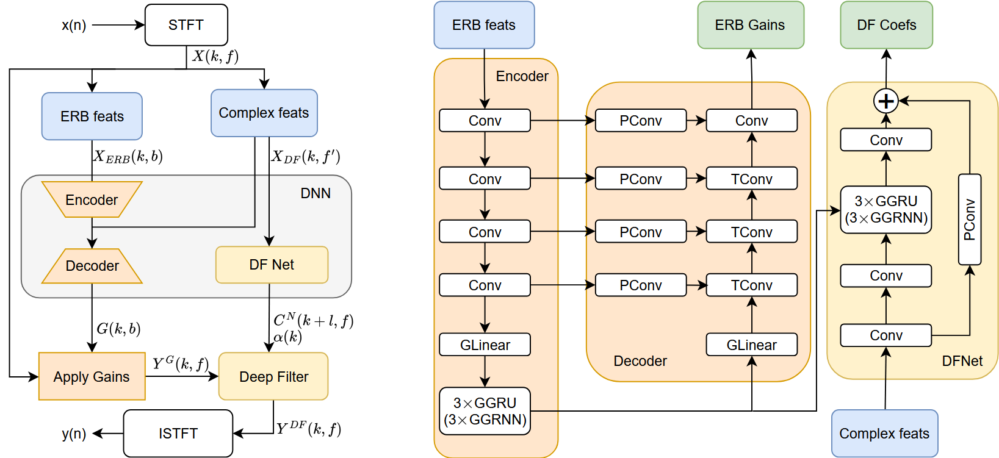

# Speech Enhancement Algorithms for Low-Resource Devices

We investigate parameter-efficient modifications of DeepFilterNet by replacing GRU blocks with FastGRNN and exploring alternative convolutional designs. Our approach significantly reduces the model size while preserving comparable speech enhancement quality. See the [paper](https://github.com/runtime57/speech_enhancement/blob/main/paper/SpeechEnhancementAlgorithmsForLowResourceDevices.pdf) for details.



## Audio Samples

We provide an interactive demo with qualitative comparisons between the noisy signal, the original DeepFilterNet, and our proposed lightweight models.

Access the demo page [here](https://runtime57.github.io/speech_enhancement/).

All the source code for demo page can be found in `demo` branch.

## Installation

0. Create and install [`conda`](https://conda.io/projects/conda/en/latest/user-guide/getting-started.html) environment

    ```
    conda create -n speech_enhancement python=3.10 -y
    conda activate speech_enhancement
    ```

1. Clone this repository

    ```
    git clone git@github.com:runtime57/speech_enhancement.git
    cd speech_enhancement
    ```

2. Install all required packages
    ```
    pip install -r requirements.txt
    ```
3. Install pre-commit
    ```
    pre-commit install
    ```

## Experimental setup

For both training and evaluation, we used the [VCTK+DEMAND](https://datashare.ed.ac.uk/handle/10283/2791) dataset, which is widely used in speech enhancement research as a standard benchmark, which allows for direct comparison between different methods.

Configurations for all types of used baselines are listed in `src/configs/model`. Feel free to conduct your own experiments by changing used model in `src/configs`.


## Train and inference
 

To train a new model, use the following command:
```
python3 train.py -cn=CONFIG_NAME HYDRA_CONFIG_ARGUMENTS
```
Where `CONFIG_NAME` is a config from `src/configs` and `HYDRA_CONFIG_ARGUMENTS` are optional arguments

Prepare VCTK+DEMAND by placing the four extracted `clean/noisy_trainset_28spk_wav`
and `clean/noisy_testset_wav` directories in `data/`, then run:

```bash
python prepare_data.py -cn=dfnet
python train.py -cn=dfnet writer=tensorboard writer.run_name=dfnet_audited_20261013
```

Preparation pairs files by their relative names, resamples to mono 16 kHz, and
writes waveform caches under `data/vctk/`. Empty or missing caches are rebuilt.
DFNet holds out speakers `p226` and `p287` for validation, trains on random paired
3-second crops, and selects checkpoints by validation loss. The test partition is
reserved for final evaluation. The training objective uses the compressed spectral
and squared alpha losses from the original paper, excluding padded frames; LR
decays by 0.9 every 3 epochs. The maximum budget is 100 epochs with patience 10.

TensorBoard stores local events inside the run directory. Open the dashboard with:

```bash
tensorboard --logdir saved/dfnet_audited_20261013/tensorboard --host 127.0.0.1 --port 6006
python inference.py inferencer.from_pretrained=saved/dfnet_audited_20261013/model_best.pth
```

Training and inference share length-aware STFT features and waveform reconstruction.
DFNet logs to the Comet project `speech_enhancement`; the writer reads the key
from `COMET_API_KEY` or the ignored `.comet_key` file in the repository root.
Metrics include both the batch `step` and the training `epoch`. Select **Epoch**
as the chart's X axis in Comet. The `epoch/loss_train`, `epoch/PESQ_val`, etc.
series contain one complete-epoch value; ordinary train series also contain
cumulative values logged during the epoch.

A run already using TensorBoard can publish its complete epoch summaries to
Comet without restarting training:

```bash
python sync_comet.py --run-dir saved/dfnet_audited_20261013 --follow --pid-file outputs/dfnet_restart/train.pid
```

The synchronizer replays `info.log` and saves its experiment URL and confirmed
epoch in `comet_sync.json` inside the run directory. Repeating the command resumes
the same experiment. It publishes one final value per epoch as `loss_train`,
`PESQ_val`, etc. Add `--transport windows` when Windows Python 3.11 with
`requests` is available and WSL networking cannot reach Comet. With this mode,
network retries run in a separate process and never delay the trainer.

To run inference (evaluate the model or save predictions):
```
python3 inference.py -cn=CONFIG_NAME HYDRA_CONFIG_ARGUMENTS  # for metrics
python3 tech_eval.py  # for params, MACs and other technical metrics. Choose the model in tech_eval.yaml
```

use `from_pretrained` field in a `{model_name}.yaml` file to load the checkpoint you need from `models/{model_name}`.

### FastGRNN execution and precision

FastGRNN projects the entire sequence at once. On NVIDIA GPUs with compute capability
8.0 or newer, the default sigmoid/tanh recurrence uses persistent Triton forward and
backward kernels. The equations, parameter names and checkpoint format are preserved.
The first call compiles kernels; changing sequence length does not require recompilation.
The fast backend supports up to 128 hidden units per group and first-order gradients.
Other devices, activations and dtypes use the PyTorch implementation. To select it
explicitly, pass `+model.grnn_backend=torch` when using a GRNN model config.
Triton 3.1.0 and PyTorch 2.5.1 were used for validation.

`grnn.yaml` enables CUDA AMP with float16 operations and float32 model weights by
default, both during training and validation. Training uses GradScaler, unscales
gradients before clipping, and saves scaler state in checkpoints. STFT, ISTFT,
losses and the recurrent state inside the fast kernel stay in float32.

```bash
python train.py -cn=grnn trainer.amp=true trainer.amp_dtype=float16
python train.py -cn=grnn trainer.amp=false
python train.py -cn=grnn trainer.amp_dtype=bfloat16
python denoise.py denoise.precision=amp
python denoise.py denoise.precision=fp16
python denoise.py denoise.precision=fp32
```

`denoise.precision=fp16` converts model weights to half precision for inference.
Waveform preprocessing and reconstruction remain float32. The default denoise
mode is `amp`; on CPU, AMP is disabled automatically.

Reproduce the correctness checks and model timings with:

```bash
python -m unittest discover -s tests -v
python benchmark_grnn.py --output benchmarks/grnn_fp32.json
python benchmark_grnn.py --precision amp --models deepfilternet deepfilternetgrnn grnn_emb_128 grnn_emb_256 grnn_emb_384 --output benchmarks/grnn_amp.json
python benchmark_grnn.py --precision fp16 --models deepfilternet deepfilternetgrnn grnn_emb_128 grnn_emb_256 grnn_emb_384 --output benchmarks/grnn_fp16.json
python benchmark_grnn.py --models grnn_emb_256 grnn_emb_384 rebalancedgrnn rebalanced2grnn rebalanced3grnn --seq-lengths 200 --output benchmarks/grnn_widths_fp32.json
env OMP_NUM_THREADS=1 MKL_NUM_THREADS=1 OPENBLAS_NUM_THREADS=1 taskset -c 0 python benchmark_grnn.py --device cpu --models deepfilternet deepfilternetgrnn_original deepfilternetgrnn grnn_emb_128 grnn_emb_256 grnn_emb_384 --output benchmarks/grnn_cpu_fp32.json
```

On an RTX 4070, batch size 32 and 200 frames, the median warmed-up timings
for the complete model were:

| Model | Parameters | Forward (ms) | Forward + backward (ms) |
|---|---:|---:|---:|
| GRU, float32 | 1,695,703 | 23.35 | 79.50 |
| Original GRNN, float32 | 1,046,647 | 163.19 | 652.44 |
| Fast GRNN, float32 | 1,046,647 | 19.64 | 66.36 |
| GRU, AMP | 1,695,703 | 21.42 | 69.06 |
| Fast GRNN, AMP | 1,046,647 | 13.26 | 43.13 |
| Fast GRNN-128, AMP | 360,055 | 12.14 | 39.36 |

In the GPU table, float32 describes tensor storage. The fast CUDA recurrence uses
TF32x3 for some matrix products; these rows are not measurements of exclusively
IEEE float32 arithmetic.

These measurements cover model execution with a synthetic loss, excluding optimizer
steps, audio preprocessing, data loading and metrics. The JSON reports in
[`benchmarks`](benchmarks) include batches 1/32 and sequence lengths 200/400,
plus a comparison of the rebalanced models at 200 frames.
Tests compare outputs and gradients against the previous equations and exercise an
actual AMP optimizer step, validation and half precision denoising on local audio.

CPU measurements on an AMD Ryzen 7 7700X use float32, PyTorch 2.5.1 with MKLDNN
enabled, one intra-op and one inter-op thread, and affinity to logical CPU 0.
GRNN uses the PyTorch backend. For 200 frames, the median of 10 iterations after
3 warmup iterations is shown below; all times are per batch in milliseconds.

| Model | Parameters | Forward, B=1 | Forward + backward, B=1 | Forward, B=32 | Forward + backward, B=32 |
|---|---:|---:|---:|---:|---:|
| GRU | 1,695,703 | 102.31 | 790.21 | 1329.55 | 4584.97 |
| Original GRNN | 1,046,647 | 54.25 | 295.69 | 654.04 | 5908.94 |
| Fast GRNN | 1,046,647 | 36.86 | 174.51 | 657.86 | 3167.89 |
| Fast GRNN-128 | 360,055 | 33.14 | 154.41 | 509.35 | 2754.23 |
| Fast GRNN-256 | 552,055 | 33.58 | 155.56 | 568.25 | 2948.94 |
| Fast GRNN-384 | 780,919 | 35.74 | 163.29 | 604.22 | 3126.73 |

At batch 32 and 400 frames, GRU takes 1687.85 ms for forward and 10444.08 ms
for forward + backward. The current GRNN takes 1468.54 / 8447.90 ms, compared
with 1344.26 / 30053.65 ms for the previous GRNN implementation. CPU forward
does not consistently improve over the previous GRNN; the backward savings
increase with sequence length.

The scope matches the GPU benchmark above: model execution and a synthetic loss,
excluding optimizer steps, audio preprocessing, data loading and metrics.
[`benchmarks/grnn_cpu_fp32.json`](benchmarks/grnn_cpu_fp32.json) records hardware,
thread settings and timings for batches 1/32 and sequence lengths 200/400.

## Results on VCTK+DEMAND dataset


| Model           | Params (M) | MACs (G) | PESQ    | STOI    | SI-SDR   |
|----------------|-----------:|---------:|--------:|--------:|---------:|
| Original DFNet | 1.78       | 0.35     | **2.81** | **0.94** | 16.63    |
| Our DFNet      | 1.69       | 0.51     | 2.31    | 0.93    | **17.04** |
| FastDFNet      | 1.04       | 0.34     | 2.26    | 0.93    | 17.00    |
| Rebalanced-1   | **1.03**   | 0.25     | 2.21    | 0.92    | 16.53    |
| Rebalanced-2   | 1.09       | 0.21     | 2.24    | 0.92    | 16.83    |
| Rebalanced-3   | 1.15       | **0.19** | 2.16    | 0.92    | 16.49    |
| DWS            | 1.04       | 0.32     | 2.25    | 0.93    | 16.86    |
| MB             | 1.08       | 0.52     | 2.24    | 0.93    | 16.96    |
| Conv           | 1.11       | 0.68     | 2.25    | 0.93    | 16.97    |
| XDWS           | 1.11       | 0.32     | 2.24    | 0.92    | 16.71    |
| XMB            | 1.17       | 0.50     | 2.25    | 0.93    | 16.79    |
| XConv          | 1.12       | 0.68     | 2.26    | 0.93    | 16.77    |


Best values per column are highlighted in **bold**.
Due to limited computational and storage resources, we did not evaluate our models on the DNS Challenge dataset.

## Future work

- Benchmark on DNS Challenge dataset for better comparability with recent methods
- Explore GAN-based training to improve perceptual quality (e.g., PESQ)
