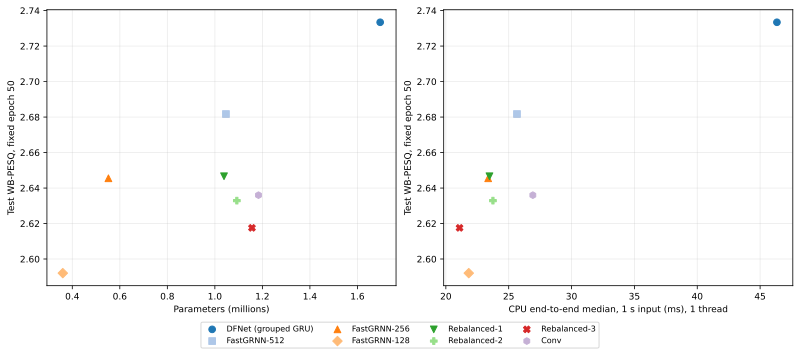
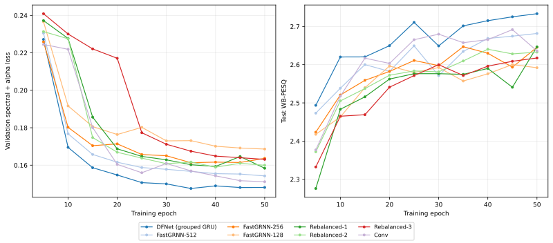

# CPU performance and fixed-budget speech enhancement results

Study updated: 2026-10-15 15:43 UTC. CPU measurements: 13 model architectures; completed epoch-50 quality results: 7/13.

## CPU protocol

Hardware: **AMD Ryzen 7 7700X 8-Core Processor**, WSL2 on Windows (shared desktop host). Software: Python 3.10.19, PyTorch 2.5.1+cu121, FP32, evaluation mode, inference mode, oneDNN enabled. Batch size is 1. One-thread runs are pinned to logical CPU 0; four-thread runs use CPUs 0, 2, 4, 6 (four distinct physical cores). PyTorch inter-op threads = 1, denormals are flushed. Concurrent GPU training is pinned to CPUs 8–15. These are timings of this repository's Python/PyTorch implementations at 16 kHz, not the upstream Rust/C++ DeepFilterNet runtime.

Inputs are fixed **1 s and 5 s middle crops** of 15 eligible official test recordings per duration, with two passes (30 timed observations) after 5 warm-up calls per duration. Waveforms are loaded before timing. The same clips, crop offsets and audio hashes are recorded for every model. The network-only measurement excludes feature extraction. End-to-end timing includes STFT, ERB/DF feature extraction and normalization, the model, and ISTFT; it excludes disk I/O, resampling, losses and quality metrics. Network-only and end-to-end calls are interleaved per clip. Outputs are checked for correct length and finite samples.

**RTF = processing seconds / audio seconds** (lower is better); throughput is `1 / RTF` audio seconds per wall-clock second. Latency below is the processing time of a whole buffered utterance. It does not measure streaming packet deadlines, first-sample latency or algorithmic look-ahead. The STFT is centered, with FFT/window = 320 samples (20 ms) and hop = 160 samples (10 ms).

## Main performance table: 1 s inputs

| Model | Params (M) | FP32 state (MiB) | Neural MMAC/s | Network p50 (ms) | End-to-end p50 / p95 (ms) | RTF, 1 thread | RTF, 4 threads | Throughput, 1 thread (× real time) |
|---|---:|---:|---:|---:|---:|---:|---:|---:|
| DFNet (grouped GRU) | 1.696 | 6.49 | 286.49 | 41.22 | 46.34 / 63.41 | 0.0463 | 0.0505 | 21.6 |
| FastGRNN-512 | 1.047 | 4.01 | 221.95 | 19.76 | 25.66 / 28.62 | 0.0257 | 0.0218 | 39.0 |
| FastGRNN-256 | 0.552 | 2.13 | 172.26 | 17.94 | 23.37 / 38.72 | 0.0234 | 0.0216 | 42.8 |
| FastGRNN-128† | 0.360 | 1.39 | 153.00 | 18.10 | 23.66 / 28.61 | 0.0237 | 0.0228 | 42.3 |
| Rebalanced-1 | 1.039 | 3.98 | 172.81 | 18.27 | 23.47 / 25.41 | 0.0235 | 0.0253 | 42.6 |
| Rebalanced-2 | 1.093 | 4.19 | 156.74 | 17.64 | 23.75 / 27.55 | 0.0237 | 0.0204 | 42.1 |
| Rebalanced-3 | 1.156 | 4.43 | 149.06 | 16.01 | 21.09 / 22.07 | 0.0211 | 0.0195 | 47.4 |
| DWS† | 1.044 | 4.01 | 203.49 | 21.94 | 27.12 / 28.86 | 0.0271 | 0.0228 | 36.9 |
| MB† | 1.082 | 4.16 | 300.30 | 24.24 | 30.09 / 33.95 | 0.0301 | 0.0241 | 33.2 |
| Conv | 1.184 | 4.54 | 373.80 | 21.39 | 26.92 / 29.13 | 0.0269 | 0.0237 | 37.1 |
| XDWS† | 1.111 | 4.26 | 203.49 | 34.29 | 39.56 / 42.46 | 0.0396 | 0.0292 | 25.3 |
| XMB† | 1.180 | 4.53 | 300.30 | 45.89 | 51.87 / 56.14 | 0.0519 | 0.0343 | 19.3 |
| XConv† | 1.214 | 4.65 | 373.80 | 30.51 | 36.98 / 44.80 | 0.0370 | 0.0254 | 27.0 |

FP32 state is the total byte size of model parameters and buffers, excluding optimizer state, serialization overhead, Python/PyTorch runtime and activation memory. Neural MACs count Conv2d, ConvTranspose2d (input-lattice convention), Linear, grouped linear and recurrent matrix products; one multiply–accumulate counts as one MAC. FFT, bias additions, activations, normalization and parameter-free deep filtering are excluded. For 1 s inputs, centered STFT produces 101 frames; these boundary frames are included.

† CPU timing currently uses seed-1 initialization because a complete 50-epoch checkpoint was not available at measurement time. This measures the dense architecture's execution cost; it does not constitute a quality result. Unmarked rows load this study's exact epoch-50 checkpoint. Raw reports contain checkpoint SHA-256 hashes. After the remaining checkpoints become available, rerunning the benchmark updates only affected rows.

## Longer inputs and timing uncertainty

| Model | 5 s end-to-end p50 / p95 (ms), 1 thread | 5 s RTF, 1 thread | 5 s RTF, 4 threads | 1 s p50 bootstrap 95% interval (ms), 1 thread |
|---|---:|---:|---:|---:|
| DFNet (grouped GRU) | 217.42 / 227.95 | 0.0435 | 0.0421 | [46.17, 47.10] |
| FastGRNN-512 | 116.20 / 139.67 | 0.0232 | 0.0193 | [25.38, 25.93] |
| FastGRNN-256 | 106.17 / 119.66 | 0.0212 | 0.0181 | [23.12, 23.75] |
| FastGRNN-128 | 106.44 / 127.65 | 0.0213 | 0.0198 | [22.94, 24.53] |
| Rebalanced-1 | 105.90 / 111.41 | 0.0212 | 0.0195 | [23.17, 23.72] |
| Rebalanced-2 | 106.86 / 130.78 | 0.0214 | 0.0187 | [23.42, 24.30] |
| Rebalanced-3 | 94.79 / 109.16 | 0.0190 | 0.0172 | [20.85, 21.31] |
| DWS | 124.99 / 130.85 | 0.0250 | 0.0195 | [26.82, 27.46] |
| MB | 151.50 / 171.76 | 0.0303 | 0.0229 | [29.88, 30.29] |
| Conv | 121.86 / 135.57 | 0.0244 | 0.0197 | [26.59, 27.11] |
| XDWS | 211.31 / 225.59 | 0.0423 | 0.0269 | [39.42, 40.42] |
| XMB | 287.60 / 316.84 | 0.0575 | 0.0334 | [51.18, 52.62] |
| XConv | 165.55 / 185.33 | 0.0331 | 0.0235 | [36.52, 37.49] |

Timing intervals are percentile bootstrap intervals of the median over the 30 observed runtimes (2,000 resamples; fixed seed 20261015), conditional on the selected clips and this shared host. They are not confidence intervals for enhancement quality or cross-device generalization.

On this host, the full FastGRNN-512 model processes a 1 s waveform 1.81× faster than the grouped-GRU DFNet, with 38.3% fewer parameters. Four threads do not uniformly improve short-utterance latency. The X-variants also illustrate why MAC counts should be accompanied by measured runtime: elementwise work and framework dispatch are outside the neural-MAC estimate.

## Quality at an equal training budget

Every enhanced result below is the committed **last epoch 50**, with 10,802 training recordings, 770 speaker-held-out validation recordings and all 824 official test recordings. The test set is not used to select a checkpoint. No best-over-70/94-epoch result is substituted. Baseline DFNet/FastGRNN-512/FastGRNN-256 originally ran longer, but only their epoch-50 results are compared here. Runs use the same full-recording loss/optimizer recipe and effective batch 32, seed 1. Published values are the training evaluator's sample-averaged WB-PESQ, STOI and SI-SDR (AMP inference); the CPU speed benchmark uses FP32. A single seed is used, so no claim of statistical superiority is made.

| Model | Epoch | Test recordings | WB-PESQ ↑ | STOI ↑ | SI-SDR (dB) ↑ |
|---|---:|---:|---:|---:|---:|
| Noisy (unprocessed) | — | 824 | 1.966 | 0.9211 | 8.44 |
| DFNet (grouped GRU) | 50 | 824 | 2.733 | 0.9374 | 17.76 |
| FastGRNN-512 | 50 | 824 | 2.682 | 0.9356 | 18.07 |
| FastGRNN-256 | 50 | 824 | 2.646 | 0.9317 | 18.03 |
| FastGRNN-128 (training pending/in progress) | — | — | — | — | — |
| Rebalanced-1 | 50 | 824 | 2.647 | 0.9338 | 18.02 |
| Rebalanced-2 | 50 | 824 | 2.633 | 0.9339 | 18.03 |
| Rebalanced-3 | 50 | 824 | 2.618 | 0.9333 | 18.03 |
| DWS (training pending/in progress) | — | — | — | — | — |
| MB (training pending/in progress) | — | — | — | — | — |
| Conv | 50 | 824 | 2.636 | 0.9357 | 18.19 |
| XDWS (training pending/in progress) | — | — | — | — | — |
| XMB (training pending/in progress) | — | — | — | — | — |
| XConv (training pending/in progress) | — | — | — | — | — |

## Figures for the article





Both figures have vector SVG and 220-dpi PNG versions in `paper/graphics`. They use measured timings and completed epoch results only. Curves are sampled every five epochs for a common display cadence.

## Reproduction and raw evidence

```bash
OMP_NUM_THREADS=1 OPENBLAS_NUM_THREADS=1 python benchmark_cpu.py
taskset -c 0 python paper_results.py --noisy-baseline
python paper_results.py
```

- [Raw CPU observations, clip identities and checkpoint hashes](../../benchmarks/cpu_speech_enhancement_20261015.json)
- [Raw training/evaluation histories used for quality and figures](../../benchmarks/training_curves_20261015.json)
- [Noisy-baseline per-recording scores](../../benchmarks/noisy_test_baseline_20261015.json)
- [CPU measurement code](../../benchmark_cpu.py)
- [Table/figure and Noisy-baseline code](../../paper_results.py)
- [Comet project](https://www.comet.com/runtime57/speech-enhancement)

CPU measurements depend on this desktop/WSL2 host and these PyTorch implementations. They support controlled comparisons within the table, rather than absolute latency claims for ARM, microcontrollers or a streaming implementation.
